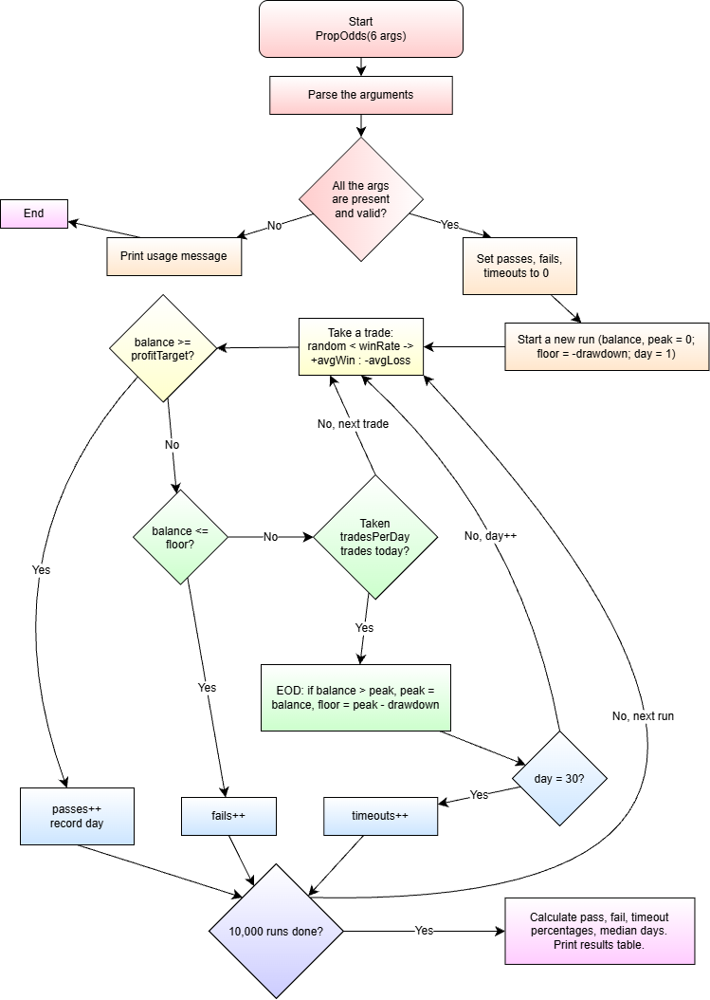

# PropOdds

Monte Carlo simulator that estimates your odds of passing a prop-firm trading evaluation.

## The Problem

I trade futures on prop-firm evaluation accounts, where you have to reach a profit target before hitting a trailing drawdown. Your chances of successfully passing an evaluation depends on your average win, average loss, w/l % and the account's rules, and that is difficult to calculate in a real-world probabilistic way. I want to know my actual odds before paying for an evaluation.

## MVP Scope

- Read win rate, average win, average loss, trades per day, profit target and drawdown from the command line
- Simulate trading paths trade by trade with random wins and losses
- Stop each path at the profit target (pass), the end-of-day trailing drawdown (failed) or 30 days (timeout)
- Run 10,000 paths and print pass%, fail%, timeout% and median days to pass

Matrix: [Eisenhower_Matrix.pdf](Eisenhower_Matrix.pdf)

## Tech Stack

- **Language:** Java
- **Libraries:** Java standard library only (`Random`, `Arrays`)
- **Data:** none stored. The inputs come from the command line, and results print to the terminal

## Future Plans

- [ ] Daily loss limit and consistency rules
- [ ] Presets for common account types
- [ ] Read stats from a trade log CSV
- [ ] Save results to CSV

## Author

Prem Nadesan
